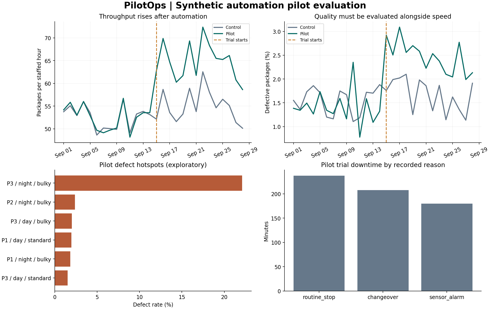

# PilotOps: Packing Trial Analysis

**A Python and SQL project looking at whether an automated packing process is worth expanding.**

The main question is simple: if a machine helps a team pack more orders, is that enough to call the trial a success?

This project checks speed alongside errors, downtime and cost. It uses made-up data from one fictional warehouse. It is an AI-assisted portfolio project, with no Amazon data or affiliation.

## The setup

There are two groups of packing stations. Both work manually for the first 14 days. For the next 14 days, one group switches to automated packing and the other stays manual. Keeping a manual group gives us a useful comparison when daily conditions change.

The data contains package records, shift details and downtime logs. A few duplicate and invalid records are deliberately added so the cleaning steps can be tested.

## What the analysis found

- Adjusted throughput increased by **17.9%**.
- The adjusted defect rate increased by **0.93 percentage points**.
- The highest defect rate was in bulky packages at station P3 on the night shift.
- Cost per good package was higher for the pilot under the stated assumptions.

**Recommendation: hold expansion, investigate the quality issue and run another trial.** The faster output is useful, but the quality and cost results need work. The station breakdown tells us where to look; it does not prove what caused the problem.



## How it works

1. Python generates the sample CSV files.
2. Pandas checks keys, duplicates, values and timestamps. Invalid records go into a separate file.
3. SQLite stores the clean data. SQL queries calculate the daily results and compare stations, shifts and product types.
4. Python compares the two groups, calculates uncertainty ranges and checks the decision rules.
5. The run produces charts, an HTML report and a CSV of issues to review.

The SQL uses joins, CTEs, grouping, `LAG` and a rolling average. Package counts and downtime are added up separately before they are joined, so the totals do not accidentally get doubled.

## Run it

Use Python 3.11 or later. The project was tested with Python 3.12.14, Pandas 2.2.3, NumPy 2.3.5 and Matplotlib 3.10.8.

```bash
python -m venv .venv
# Windows PowerShell
.venv\Scripts\Activate.ps1
# On macOS/Linux use: source .venv/bin/activate
python -m pip install -r requirements.txt
python pilotops.py
python -m unittest discover -s tests -v
```

Then open `outputs/report.html` in a browser. It works locally without a server.

For Windows commands with explanations and troubleshooting, follow [the run guide](docs/windows_run_guide.md).

After running the pipeline, try the SQL yourself:

```bash
python run_sql.py --file sql/start_here.sql
python run_sql.py --query "SELECT COUNT(*) AS valid_packages FROM package_events;"
```

The project uses SQLite, which comes with Python. No separate database server is needed. The runner only allows read access.

To check existing CSV files without generating new ones:

```bash
python pilotops.py --reuse-raw
```

The normal run replaces generated data and reports. Keep personal files outside those folders.

## Main files

| File or folder | What it contains |
|---|---|
| `pilotops.py` | Data generation, checks, analysis and reporting |
| `run_sql.py` | Run SQL files or a single query against the generated database |
| `examples/` | A saved chart that displays on GitHub before running the project |
| `config.json` | Seed, snapshot date, thresholds and cost assumptions |
| `sql/models.sql` | SQL tables of calculated results |
| `sql/diagnostics.sql` | Queries for investigating errors and product mix |
| `tests/` | 12 checks covering cleaning, calculations and pipeline failures |
| `docs/` | Trial plan, metric definitions, learning guide and site checklist |
| `data/` | Generated raw files, clean events and rejected records |
| `warehouse/` | Generated SQLite database |
| `outputs/` | Report, charts, scorecards, alerts and run log |

## Important limits

The data is synthetic and the two groups were not randomly assigned. The results show how the analysis works, rather than proving that automation causes these changes. The cost inputs are assumptions, not supplier quotes. No real equipment, site trial or safety review was involved.

The pipeline records local runs. It does not demonstrate a production service or 100% availability. The detailed methods are in `docs/methodology.md`.

## Next steps

Work through `docs/learning_path.md`, reproduce the key SQL queries and check a few results manually. An Excel reconciliation sheet or Power BI page would be useful extensions once the calculations are understood.

Generated data, the SQLite database and full reports are excluded by `.gitignore`. Run `python pilotops.py` to recreate them. A sample chart is included in `examples/`.
